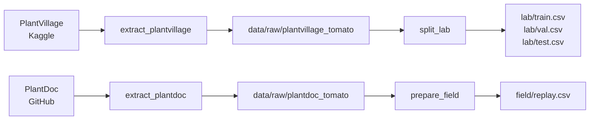

# Plant Disease MLOps: from lab images to the field

An end-to-end MLOps project for tomato leaf disease classification, built to learn and practise the full model lifecycle: data versioning, training, deployment, monitoring, and responding to drift.

## Why this project

Models trained on the popular **PlantVillage** dataset often report around 99% accuracy, but PlantVillage images are taken in controlled conditions: one leaf, plain background, even lighting. Real photos taken in the field have cluttered backgrounds, several leaves, shadows and varied lighting, and models trained only on lab images tend to perform much worse on them.

This project uses that known gap on purpose:

- **Train** on PlantVillage (the "lab world").
- **Deploy** and replay real-world **PlantDoc** images as if users were uploading them (the "field world").
- **Monitor** whether drift detection catches the problem before accuracy numbers do.
- **Respond** with fixes beyond retraining, and compare them.

## Project status

| Week | Focus | Status |
|---|---|---|
| 1 | Setup, data pipeline, data versioning | 🟡 In progress (pipeline done) |
| 2 | Baseline model, experiment tracking (MLflow) | ⬜ Planned |
| 3 | Serving API with request logging (FastAPI, Docker) | ⬜ Planned |
| 4 | Deployment and CI (GitHub Actions) | ⬜ Planned |
| 5 | Model monitoring and drift reports (Evidently) | ⬜ Planned |
| 6 | Detect and diagnose drift | ⬜ Planned |
| 7 | Respond: augmentation, segmentation, fine-tuning, abstention | ⬜ Planned |
| 8 | Release v2, out-of-scope input guard, write-up | ⬜ Planned |

## Tech stack (so far)

- **Python 3.11**, managed with **[uv](https://docs.astral.sh/uv/)**
- **[DVC](https://dvc.org/)** for data versioning and the data pipeline
- **pandas**, **scikit-learn**, **Pillow**, **PyYAML**

## Data

### Sources

| Dataset | Role | Source | Licence |
|---|---|---|---|
| PlantVillage (colour images) | Training, validation, test | [Kaggle: abdallahalidev/plantvillage-dataset](https://www.kaggle.com/datasets/abdallahalidev/plantvillage-dataset) | See dataset page |
| PlantDoc | Deployment replay only (never used in training) | [GitHub: pratikkayal/PlantDoc-Dataset](https://github.com/pratikkayal/PlantDoc-Dataset) | CC BY 4.0 |

Only **tomato** classes are used. Both datasets are mapped to one shared set of labels, so a prediction means the same thing in both.

### Classes and image counts

Counts after removing broken files and exact duplicates.

| Label | PlantVillage | PlantDoc |
|---|---:|---:|
| bacterial_spot | 2,127 | 110 |
| early_blight | 1,000 | 88 |
| healthy | 1,585 | 63 |
| late_blight | 1,901 | 111 |
| leaf_mold | 952 | 91 |
| mosaic_virus | 373 | 54 |
| septoria_leaf_spot | 1,771 | 149 |
| spider_mites | 1,676 | 2 |
| target_spot | 1,404 | — |
| yellow_leaf_curl_virus | 5,357 | 75 |
| **Total** | **18,146** | **743** |

### Splits

PlantVillage is split 70 / 15 / 15, stratified by class, with a fixed seed (42):

| Split | Images |
|---|---:|
| Train | 12,702 |
| Validation | 2,722 |
| Test | 2,722 |

All 743 PlantDoc images form the deployment replay set.

### Data notes

- **Class imbalance:** yellow leaf curl virus is about 30% of PlantVillage, while mosaic virus is about 2%. Accuracy alone will be misleading, so macro-F1 and per-class recall will be reported.
- **Label shift between datasets:** the class mix in PlantDoc differs from PlantVillage, so predicted class proportions will change in deployment even for a perfect model.
- **PlantDoc gaps:** there is no target spot class, and spider mites has only 2 images, so results for that class are not meaningful.
- **Label noise:** one PlantDoc image appears under two different classes. It is kept once, under the first label found.
- **Duplicates:** exact duplicates are removed (14 in PlantVillage, 3 in PlantDoc).

## Data pipeline

The pipeline is defined in `dvc.yaml`, configured in `params.yaml`, and reproduced with one command. The training and deployment branches are fully separate, so PlantDoc cannot leak into training.



| Stage | What it does |
|---|---|
| `extract_plantvillage` | Downloads PlantVillage, keeps only the colour versions of the 10 tomato classes, verifies each image opens, removes exact duplicates, and saves images under shared labels |
| `extract_plantdoc` | Same for PlantDoc, combining its train and test folders |
| `split_lab` | Writes stratified train / val / test manifests |
| `prepare_field` | Writes the deployment replay manifest |

Each stage writes a JSON report to `reports/` with image counts per class.

### Design choices

- **Manifests instead of copied images:** splits are CSV files of `image_path, label`, so changing a split never duplicates images.
- **Content-hash file names:** images are saved as `<md5>.jpg`, which avoids name clashes, keeps outputs identical across runs, and removes duplicates automatically.
- **All settings in `params.yaml`:** class mappings, source locations and split settings live in one file. DVC re-runs only the stages affected by a change.

## Repository structure

```
plant-disease-mlops/
├── src/
│   └── data/
│       ├── extract.py        # download, filter tomato classes, clean, save
│       └── split.py          # build train/val/test and replay manifests
├── data/                     # managed by DVC, not Git
│   ├── raw/
│   │   ├── plantvillage_tomato/<label>/
│   │   └── plantdoc_tomato/<label>/
│   └── processed/
│       ├── lab/              # train.csv, val.csv, test.csv
│       └── field/            # replay.csv
├── reports/                  # JSON reports from each stage (tracked in Git)
├── dvc.yaml                  # pipeline definition
├── dvc.lock                  # exact hashes of every input and output
├── params.yaml               # data settings
├── pyproject.toml
└── uv.lock
```

## Getting started

### Option A: Pull the versioned data

Requires access to the project's DVC remote.

```bash
git clone https://github.com/<your-username>/plant-disease-mlops.git
cd plant-disease-mlops
uv sync
uv run dvc pull
```

### Option B: Rebuild the data from source

Requires a [Kaggle API token](https://www.kaggle.com/docs/api). The PlantVillage download is about 2 GB.

```bash
git clone https://github.com/<your-username>/plant-disease-mlops.git
cd plant-disease-mlops
uv sync
uv run dvc repro
```

Always run DVC through `uv run` so each stage uses the project's environment.

## References

- Hughes, D. P., & Salathé, M. (2015). *An open access repository of images on plant health to enable the development of mobile disease diagnostics.* arXiv:1511.08060.
- Mohanty, S. P., Hughes, D. P., & Salathé, M. (2016). *Using deep learning for image-based plant disease detection.* Frontiers in Plant Science, 7, 1419.
- Singh, D., Jain, N., Jain, P., Kayal, P., Kumawat, S., & Batra, N. (2020). *PlantDoc: A dataset for visual plant disease detection.* Proceedings of the 7th ACM IKDD CoDS and 25th COMAD.
